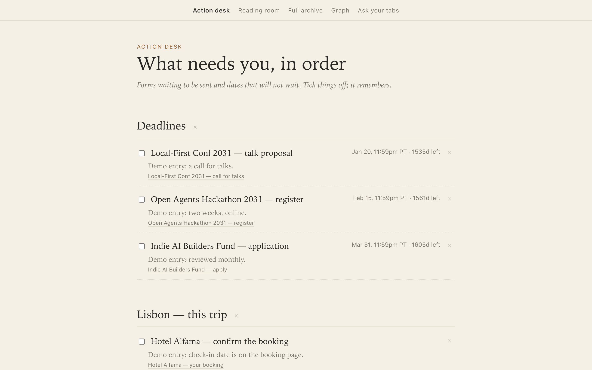
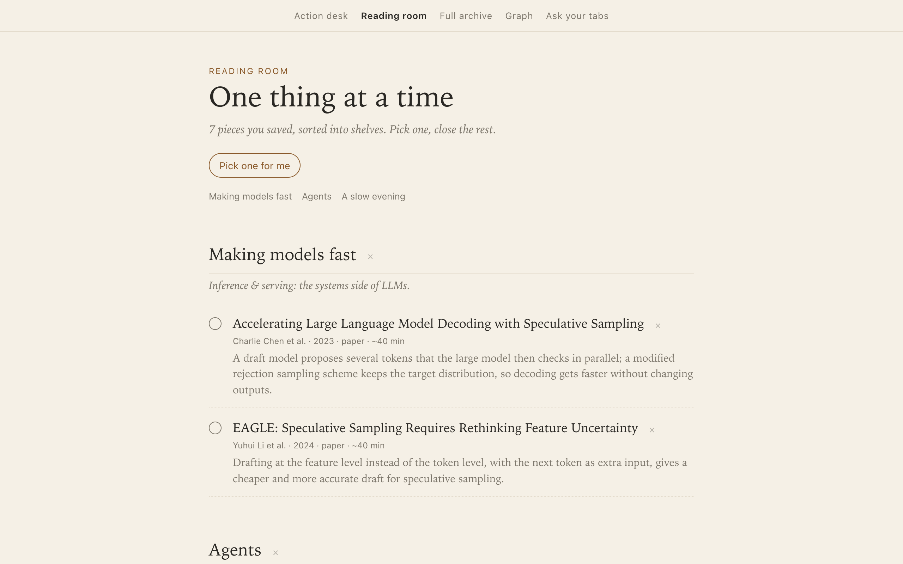
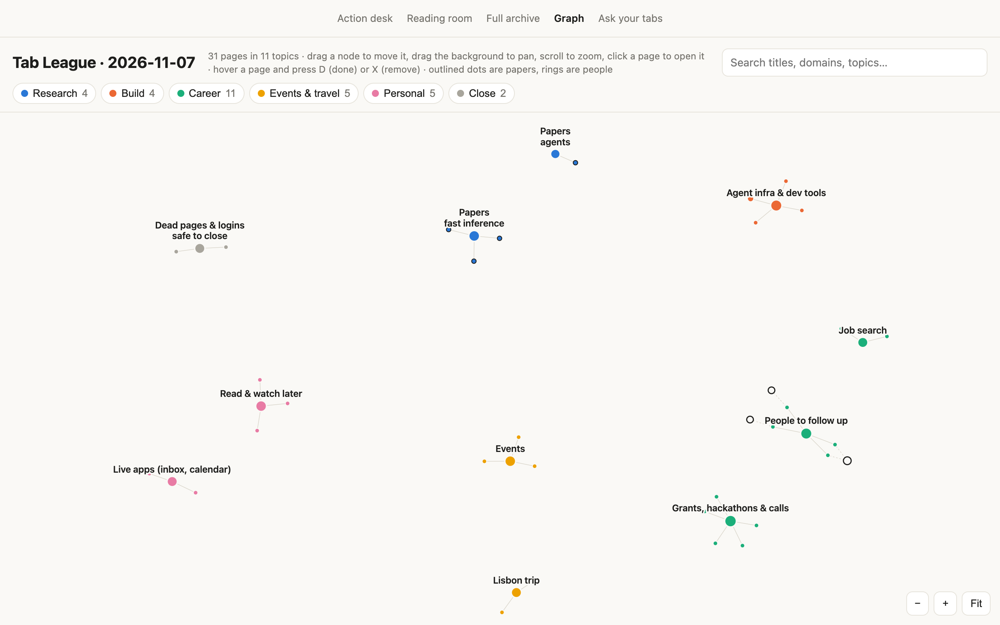
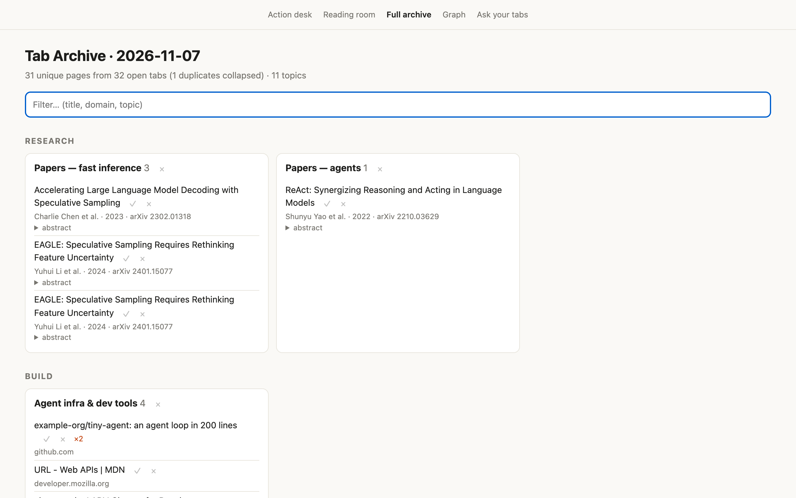
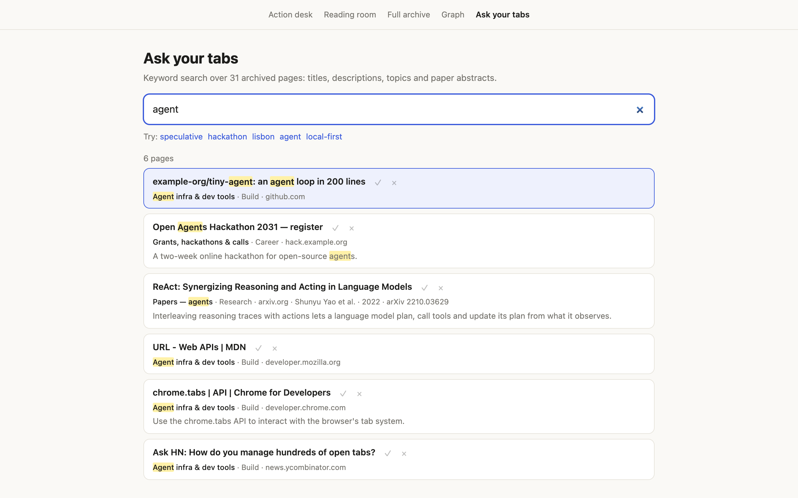

<div align="center">

# tab-league

**Close your Chrome tabs without losing the thought.**

A local-first archive, deadline desk and graph of everything you had open.

[](LICENSE)    

[Set up with your agent](#set-it-up-with-your-agent) · [Quick start](#quick-start) · [Features](#features) · [Screenshots](#screenshots) · [Use your own tabs](#use-it-on-your-own-tabs) · [How it works](#how-it-works) · [Notes for agents](#keeping-notes-for-your-agents) · [Roadmap](IDEAS.md)

<br>

<picture>
  <source media="(prefers-color-scheme: dark)" srcset="docs/images/action-desk-dark.png">
  
</picture>

</div>

## Why

People keep hundreds of tabs open because closing one feels like losing a thought. tab-league makes closing safe:
every tab goes into a personal archive and graph (topics, deadlines, people, papers, reading), so the tab itself
can go.

## Features

- **📌 Action desk.** Deadlines on a timeline, forms to finish, job applications, and dates found in your archive,
  sorted into *coming up* and *already happened*, computed live against today.
- **📚 Reading room.** Saved reading on calm shelves, with **Pick one for me** when you can't choose.
- **🗂️ Full archive.** Every page by topic, duplicates collapsed, arXiv papers enriched with authors and abstracts.
- **🕸️ Graph.** Topics as clusters, pages as nodes, people as rings (one per person, merged across X, LinkedIn,
  GitHub and Google Scholar).
- **🔎 Ask your tabs.** Instant keyword search over titles, descriptions, topics and abstracts.
- **✅ Done, remove, undo.** On every row and every section. **Close its tab** closes the real tab in Chrome.
- **🔒 Yours only.** Stdlib Python and plain JavaScript, no frameworks, no accounts. Nothing leaves your machine
  except the page fetches you run yourself.

## Screenshots

<table>
  <tr>
    <td width="50%"><br><b>Reading room</b>: one thing at a time</td>
    <td width="50%"><br><b>Graph</b>: topics, pages and people</td>
  </tr>
  <tr>
    <td width="50%"><br><b>Full archive</b>: every page, by topic</td>
    <td width="50%"><br><b>Ask your tabs</b>: what was that page about?</td>
  </tr>
</table>

<sub>All screenshots show the fictional demo snapshot that ships with the repo.</sub>

## Set it up with your agent

The easiest way in: paste this into Claude Code, Codex, Cursor or any coding agent that can run commands. It tries
the demo first, then asks before it looks at your real tabs.

```text
Set up tab-league for me: https://github.com/Shann5/tab-league
It's a local-first tool that files my open Chrome tabs into an archive, so I can close them.

1. Check what I have and tell me what's missing: macOS, Google Chrome, git, and Python 3.10 or newer.
2. Clone the repo to ~/tab-league (if that folder already exists, ask me first). Read its AGENTS.md
   before you change anything.
3. Show me the demo: run `python3 demo.py`, then start the server so it keeps running after this chat:
   cd ~/tab-league && nohup python3 serve.py > serve.log 2>&1 &
   If port 8765 is already taken, tell me what is using it; don't stop it. Then give me
   http://localhost:8765 to open.
4. Stop here and ask whether I want it on my real tabs. If I say yes:
   a. Run `python3 snss.py` to snapshot my Chrome tabs into data/tabs.json.
   b. Read the titles and URLs. Replace TOPICS in organize.py with topics for my tabs (dead pages and
      logins go in a "Close" area). Show me the topics and let me adjust them.
   c. Replace the lists in desk.py from my tabs: forms with deadlines (check the dates on the live pages),
      rolling forms, job applications, reading shelves.
   d. Ask me before running `python3 fetch_meta.py`: it visits each page once to get its description.
   e. Rebuild with `python3 organize.py && python3 desk.py && python3 graph.py && python3 search.py`,
      restart the server, and tell me what to look at first.
   f. Commit my organize.py and desk.py on a local branch named "mine", so I can pull updates later
      without losing them. Never push that branch.
5. Rules for the whole session: data/ and out/*.html are my browsing history. Never commit them, paste
   them into an issue, or send them to any website. Don't press the "close its tab" buttons yourself.
6. At the end, ask whether to start it at login (`python3 serve.py --install`).
```

Worth knowing before you paste it:

- **Your agent will read your tab titles and URLs** in step 4. They go to your agent's model provider, like
  anything else in the chat. Page contents are only fetched in step 4d, and only if you say yes.
- **The first time you close a tab from a page**, macOS asks whether to let the server control Google Chrome.
  Allow it, or the close buttons won't work.
- **To update later**, ask your agent: *"In ~/tab-league, pull the latest tab-league into my 'mine' branch,
  rebuild the pages and restart serve.py."*

## Quick start

Prefer to do it by hand? Needs macOS (for the Chrome integration; the views themselves work anywhere) and Python 3.10+.

```sh
git clone https://github.com/Shann5/tab-league && cd tab-league
python3 demo.py        # a fictional 32-tab snapshot → data/, builds every view
python3 serve.py       # open http://localhost:8765
```

## Use it on your own tabs

```sh
python3 snss.py        # reads Chrome's session files → data/tabs.json (all profiles)
```

(`demo.py` won't overwrite it afterwards.) Then sort your tabs into topics. **This part is curated, not
automatic**: `organize.py` holds a hand-written `TOPICS` list (area, topic name, indices into `data/tabs.json`),
and `desk.py` holds the Action desk and Reading room lists (`DATED`, `TRIP`, `ROLLING`, `JOBS`, `READING`, ...),
also by index. Both currently describe the demo. Replace them with your own; a coding agent does this well:

> Read AGENTS.md. My snapshot is in data/tabs.json. Replace TOPICS in organize.py with topics for my tabs (dead
> pages and logins go in a "Close" area), then replace the lists in desk.py from my tabs: forms with deadlines
> (check the dates on the live pages), rolling forms, job applications, reading shelves.

Then build and serve:

```sh
python3 organize.py    # data/topics.json, out/index.html, out/bookmarks.html
python3 fetch_meta.py  # fetches each page once for descriptions → data/meta.json
python3 desk.py && python3 graph.py && python3 search.py
python3 serve.py       # http://localhost:8765 ; --install starts it at login
```

> [!WARNING]
> Your snapshot (`data/`) and the pages built from it (`out/*.html`) are your browsing history. They are
> gitignored; keep it that way, and don't paste them into issues.

## How it works

```text
Chrome session files ──► snss.py ──► data/tabs.json
                                          │
                          organize.py ◄───┘  (your TOPICS)
                               │
          ┌────────────┬───────┴─────┬─────────────┐
       desk.py      graph.py     search.py     fetch_meta.py
          │            │             │          (descriptions, arXiv)
          ▼            ▼             ▼
   out/actions.html  graph.html  search.html  …  ──►  serve.py :8765 ──► Chrome (close tabs via AppleScript)
```

| Piece | What it does |
|---|---|
| `snss.py` | Reads Chrome's session files for every profile, no extension needed. |
| `organize.py` | Groups tabs into your topics and builds the full archive. Run it first; the others read its output. |
| `desk.py`, `graph.py`, `search.py` | Build the Action desk and Reading room, the graph, and the search page. |
| `brain/` | Small dependency-free ES modules (URLs, dates, people, trails, budget) shared by the pages and tests. |
| `serve.py` | Serves the views, saves done/removed marks to `data/status.json`, and closes tabs in Chrome. |

<details>
<summary><b>Development and tests</b> (Node 22+)</summary>

```sh
npm install                                   # TypeScript (type checks) and playwright-core (tests)
npx playwright-core install chromium          # Chrome for Testing, for the browser tests
npm run check && npm run test:brain && npm run test:views && npm test
```

</details>

## Keeping notes for your agents

This repository stores what agents need to know in three files, so any agent (Claude Code, Codex, Cursor, ...)
can pick up the work without the conversation that produced it:

| File | Holds | Changes |
|---|---|---|
| `AGENTS.md` | The stable map: what each file does, commands, conventions, gotchas, current state, lessons. | Edited in place; kept short and true. |
| `CLAUDE.md` | One line, `@AGENTS.md`, so Claude Code reads the same file (one source of truth). | Never. |
| `IDEAS.md` | The running log: thesis, dated findings, opinions (with who holds them), decisions, backlog, open questions. | New entries at the top of each section, dated. |

The rule for agents, stated at the top of `AGENTS.md`: when you learn something the next agent would need, write
it down before you finish: a stable fact or a gotcha goes in `AGENTS.md`; a finding, decision or idea goes in
`IDEAS.md` with a date. Commit it with the code it explains.

<details>
<summary><b>Adopting this repository, or using the same system elsewhere</b></summary>

**When you adopt this repository, make the notes yours:**

1. Keep `AGENTS.md`'s map, commands, conventions and gotchas (they describe the code), and update its **State**
   section as your copy changes.
2. In `IDEAS.md`, keep what still fits (thesis, backlog, architecture) and start your own Findings, Decisions and
   Open questions.
3. Opinions in `IDEAS.md` name who holds them; add your own the same way, so agents know whose call each one is.
4. Personal facts that should not travel with the code (your accounts, your preferences across projects) belong
   in your agent's own memory or user-level instructions, not in the repository.

**To use the same system in another project:** create `AGENTS.md` with the sections above (what this is, map,
commands, conventions, gotchas, state, lessons) and the note-keeping rule at the top, `CLAUDE.md` containing
`@AGENTS.md`, and a dated log like `IDEAS.md`. Ask your agent to fill them from the code and keep them current.

</details>

## Status

An early, personal tool that works day to day on macOS with Chrome. The Chrome extension in `extension/` (park
and reopen topics, save form drafts, unload background tabs) is paused: it needs developer mode or a Web Store
listing. See [`IDEAS.md`](IDEAS.md) for the backlog and open questions.

Issues and pull requests are welcome. Please use the demo snapshot, never your own `data/`, in bug reports.

## License

[MIT](LICENSE) © litchamber
